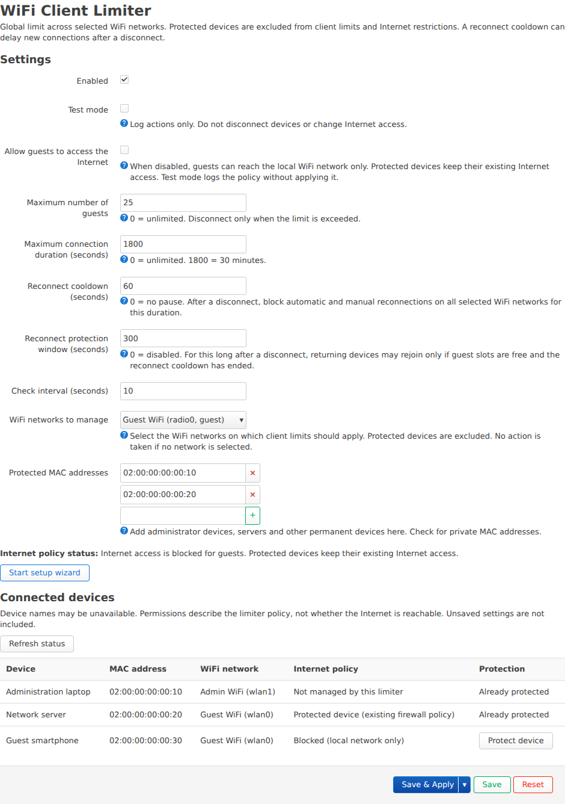
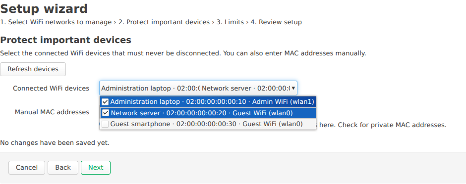
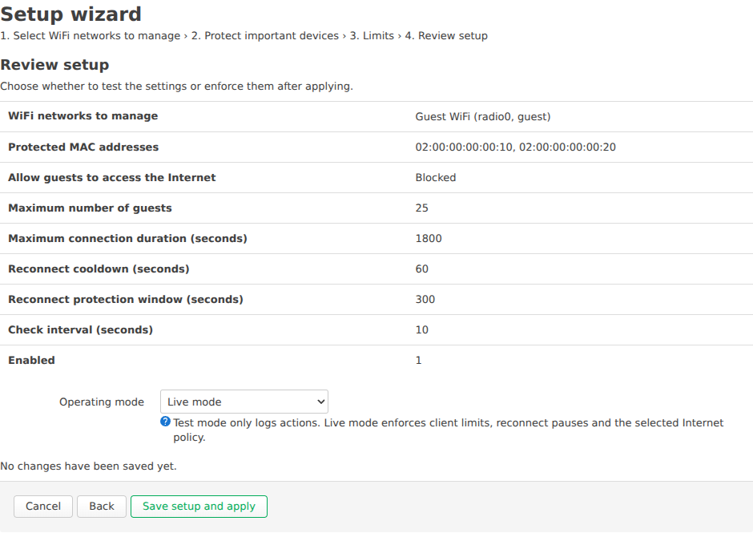

# OpenWrt WiFi Client Limiter

Limit WiFi guests across selected OpenWrt access points, protect permanent devices and choose whether guests may access the Internet or only local services. Configure everything in LuCI with a setup assistant and a live device list.

**Version 0.5.10.** [English installation guide](docs/INSTALL.md) · [Deutsche Anleitung](docs/INSTALL.de.md) · [Release notes](docs/CHANGELOG.md)

## Quick start

Download the package for your router's package manager:

| Router | Download | Installation |
| --- | --- | --- |
| Compatible `opkg` firmware, including OpenWrt 22.03–24.10 and the supported GL-X3000 profile | [IPK 0.5.10-1](packages/0.5.10/luci-app-wifi-client-limiter_0.5.10-1_all.ipk) | LuCI **System → Software → Upload Package…**. [Instructions](docs/INSTALL.md#install-an-ipk-through-luci). |
| OpenWrt 25.12 with `apk` | [Signed APKv3 0.5.10-r1](packages/0.5.10/luci-app-wifi-client-limiter-0.5.10-r1.apk) | Verify the [publisher public key](packages/0.5.10/wifi-client-limiter.pem.pub), install it and add the package over SSH. [Instructions](docs/INSTALL.md#install-an-apk-on-openwrt-2512). |

Verify your downloads against [SHA256SUMS](packages/0.5.10/SHA256SUMS). Read the [firmware requirements](#requirements) before installation. IPK and APK are different formats and cannot be exchanged.

After installation, reload LuCI and open **Services → WiFi Client Limiter**:

1. Select the WiFi AP networks to manage. Both bands can share one guest limit; a separate guest SSID is optional.
2. Protect your administrator device and any permanent devices on those networks.
3. Set the guest limit and optional connection duration. Leave **Allow guests to access the Internet** checked for normal access, or uncheck it for local services only.
4. Choose **Test mode** to inspect proposed actions or **Live mode** to enforce the settings, then save and apply. New setups default to test mode.
5. Check the status and try the configured limits on your router. For an Internet-block test on a phone, turn off mobile data and check both local access and external IPv4/IPv6 access.

To protect another connected device later, choose **Protect device** in its row and then **Save & Apply**. The button adds the MAC to the form and preserves your other pending edits.

## Features

- One guest limit across selected local APs, with optional connection-duration limits.
- Oldest eligible guest disconnected when a new arrival exceeds the limit.
- Protected MAC addresses excluded from guest counts, disconnects and this plugin's Internet restriction.
- Reconnect cooldown and a protection window to keep returning guests from displacing others.
- Optional local-only access for guests, with IPv4 and IPv6 rules.
- Live device list with network, protection and Internet-policy status.
- Setup assistant with test/live selection, plus direct device protection from the list.
- Ten interface languages, native UCI configuration and procd service management.

## Interface screenshots

Screenshots use native LuCI widgets and example router data. [German screenshots and instructions](docs/INSTALL.de.md#verbundene-geräte-und-ihre-internetberechtigung) are also available.

**Settings:** select networks, set limits and protect connected devices.



**Setup assistant:** choose devices that should remain protected.



**Final review:** choose test mode or live operation before applying the setup.



## Requirements

Use OpenWrt with JavaScript-based LuCI, rpcd, UCI, procd and ubus. The plugin needs the firmware's existing firewall3 or firewall4, `nftables-json`, `kmod-nft-netdev`, WiFi utilities and their matching dependencies. Install dependencies from your firmware's own feeds; kernel modules must match its full kernel ABI.

AP control uses hostapd ubus (`get_clients` and `del_client`) or the supported GL-X3000 MTK adapter. The GL-X3000 path supports two exact driver binaries, including stock firmware 4.8.3 release 3, build 902. Other vendor firmware is not automatically compatible. See the [driver fingerprints and restrictions](docs/INSTALL.md#firmware-compatibility), including MTK MAC-policy and steering requirements. Mixing managed MTK and third-party hostapd APs is unsupported.

Guest Internet blocking, device discovery and device protection have been tested on a GL-X3000. Test client limits, reconnect behavior and Internet policy on your own firmware before relying on them. The package format or a successful installation alone does not establish hardware compatibility.

## Configuration

Settings are stored in `/etc/config/wifi-client-limiter` and can be edited through LuCI.

| Setting | Default | Purpose |
| --- | --- | --- |
| Enabled | Off | Enable the limiter after choosing networks and settings. |
| Test mode | On | Log decisions without disconnecting clients or applying a new Internet restriction. |
| Allow guests to access the Internet | On | Uncheck for local-only access in live mode. |
| Maximum guests | 25 | Shared count across selected APs; `0` disables the count limit. |
| Maximum connection duration | 0 seconds | `0` disables the duration limit. |
| Reconnect cooldown | 0 seconds | Minimum pause after a limit-based disconnect. |
| Reconnect protection window | 300 seconds | Remember disconnected guests; returning devices need a free guest slot. |
| Check interval | 10 seconds | Time between scans. |
| Managed networks / protected MACs | None | Select networks and protect permanent devices during setup. |

The setup assistant retains current settings when reopened. Its final save enables the limiter in the selected mode. With a limit of 25, exactly 25 guests causes no count-based disconnect; a new 26th guest triggers a decision at the next scan.

## Guest Internet access

Local-only access keeps guests connected to WiFi and lets them reach connected local network prefixes under the existing firewall policy. Protected devices retain their existing permissions. Other routed LANs are not automatically included, and a local proxy or VPN can relay traffic outside the local network. MAC protection is not authentication.

Internet restrictions temporarily suspend supported flow-offload and vendor acceleration, which can reduce routing throughput across the router. Saved settings are restored when the restriction is removed. The live policy status must show active enforcement; a WiFi connection or the presence of a rule alone does not prove blocking. See [Internet access and verification](docs/INSTALL.md#guest-internet-access).

## Reconnect protection and limits

The limiter uses periodic scans, so brief over-capacity and reconnect attempts can occur. It uses driver association age when available and first-observed timestamps otherwise. Reboots clear this RAM-based history. Only selected APs on the local router are managed.

For example, cooldown `60` and protection window `300` request a one-minute minimum pause, followed by admission only to free guest slots during the remainder of a five-minute window. Normal rules resume when a returning device is accepted or the window expires. Short AP bans and scan delays can add waiting time. See [reconnect behavior and limits](docs/INSTALL.md#reconnect-protection-and-limits).

## Languages

English, German, Simplified Chinese, Russian, French, Spanish, Polish, Italian, Brazilian Portuguese and Turkish are included. English is the fallback. General LuCI buttons use LuCI's own language packages; installer messages and logs are in English. See the [language table](docs/INSTALL.md#languages).

## Development

See [package builds and signing](packaging/README.md) for SDK builds and package verification. Run the local checks with Python 3, Node.js and a POSIX shell:

```sh
python3 test.py
```

Native packet tests use isolated Linux network namespaces and require the appropriate tools and privileges:

```sh
sudo python3 test-internet-nft.py --require
```

Regenerate screenshots with `node scripts/render-screenshots.mjs en` or `de`. The development host needs Playwright with Chromium and Python 3. The script renders the current view with example data and records [capture provenance](docs/screenshots/provenance.json).

Translation sources are in `po/`. Rebuild catalogs with `python3 compile-translations.py` and LuCI's `po2lmo` host tool. Set `PO2LMO=/path/to/po2lmo` when needed. For new languages, update `languages.json` and `files/usr/share/wifi-client-limiter/languages`, rebuild catalogs and rerun the checks.

## License

[MIT](LICENSE). Copyright © 2026 Patrick Gaisbauer, [PSPhotoBox](https://psphotobox.at).
