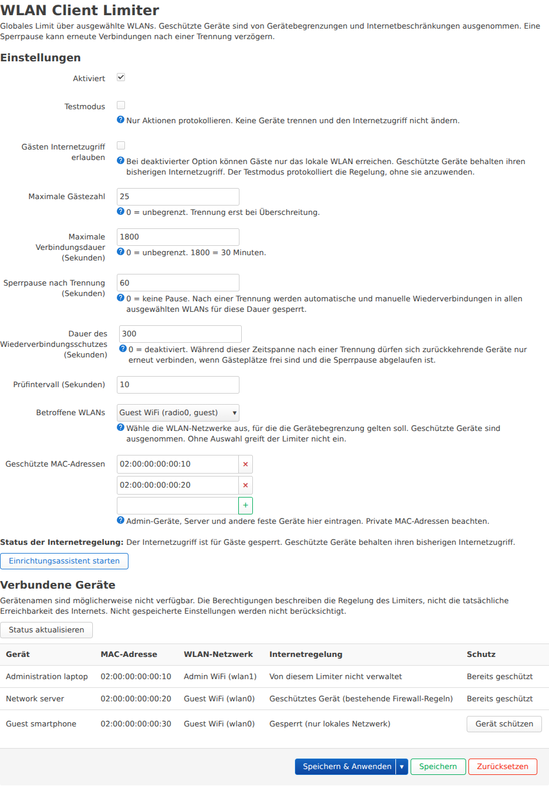
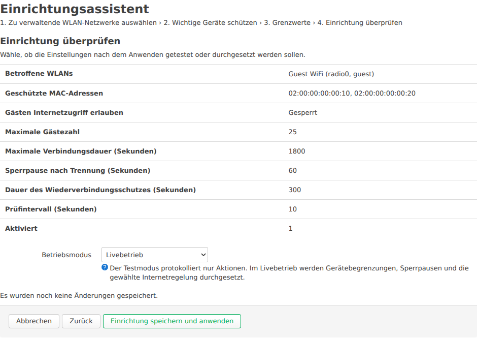

# Installation und Konfiguration

[English instructions](INSTALL.md) · [Projektübersicht](../README.md) · [Paketbau](../packaging/README.md)

**Version 0.5.10.** Installiere die LuCI-Anwendung, wähle die verwalteten WLANs und richte Gäste-Limits, geschützte Geräte und Internetzugriff ein. Die [Versionshinweise](CHANGELOG.md) beschreiben die erste öffentliche Ausgabe.

## Das passende Paket wählen

| Firmware | Paketmanager | Paket |
| --- | --- | --- |
| Unten beschriebenes originales GL-X3000-MTK-Profil | `opkg` | IPK 0.5.10-1 |
| Original-OpenWrt 22.03 bis einschließlich 24.10 mit den benötigten AP-Schnittstellen | `opkg` | IPK 0.5.10-1 |
| Original-OpenWrt 25.12 mit den benötigten AP-Schnittstellen | `apk` | Signiertes APKv3 0.5.10-r1 |

Entscheidend ist der tatsächliche Paketmanager deiner Firmware. Hersteller-Firmware kann vom Original-OpenWrt abweichen. IPK und APK sind nicht austauschbar. Das APK benötigt einen APKv3-kompatiblen Paketmanager.

| Download | Zweck |
| --- | --- |
| [luci-app-wifi-client-limiter_0.5.10-1_all.ipk](../packages/0.5.10/luci-app-wifi-client-limiter_0.5.10-1_all.ipk) | Installation auf einem kompatiblen Router mit `opkg`. |
| [luci-app-wifi-client-limiter-0.5.10-r1.apk](../packages/0.5.10/luci-app-wifi-client-limiter-0.5.10-r1.apk) | Installation auf einem kompatiblen Router mit `apk`. |
| [wifi-client-limiter.pem.pub](../packages/0.5.10/wifi-client-limiter.pem.pub) | Öffentlicher Herausgeberschlüssel zur Prüfung der APK-Signatur. |
| [SHA256SUMS](../packages/0.5.10/SHA256SUMS) | SHA256-Prüfsummen der Release-Dateien. |

Lade die benötigten Dateien aus dem Release-Verzeichnis dieses Projekts herunter. Das Quellcode-ZIP ist für den Paketbau oder die Dateiinstallation gedacht und lässt sich nicht als Paket in LuCI hochladen.

### Downloads prüfen

Vergleiche die SHA256-Prüfsumme des Pakets und bei APK-Installation auch der Schlüsseldatei mit den Einträgen in `SHA256SUMS` aus der vertrauenswürdigen Projektquelle. Zum Beispiel unter Linux:

```sh
sha256sum luci-app-wifi-client-limiter-0.5.10-r1.apk wifi-client-limiter.pem.pub
```

Unter Windows verwendest du in PowerShell `Get-FileHash -Algorithm SHA256 <Dateiname>` für jede heruntergeladene Datei. Bei einer IPK-Installation prüfst du stattdessen die `.ipk`-Datei. Eine Prüfsumme bestätigt die Übereinstimmung mit der veröffentlichten Datei. Auch der öffentliche Schlüssel muss aus einer Quelle stammen, der du vertraust.

## Voraussetzungen

- OpenWrt mit modernem JavaScript-LuCI, rpcd, `procd`, UCI und `ubus`.
- Die vorhandene firewall3- oder firewall4-Firewall, nftables und Kernelmodule aus den zur Firmware passenden Paketquellen.
- `/lib/functions.sh` und `/usr/share/libubox/jshn.sh`.
- `iw`, `iwinfo`, `wireless-tools` und übliche OpenWrt-Shellwerkzeuge aus den passenden Paketquellen der Firmware.
- Lokale AP-Steuerung über hostapd-ubus (`get_clients` und `del_client`) oder den unterstützten MTK-Herstelleradapter mit passendem `iwinfo` für die Geräteabfrage.
- Für die APK-Installation oder Dateiinstallation: SSH-Zugriff als `root` und Dateiübertragung per SCP oder SFTP.

Die Paketabhängigkeiten müssen für deine Firmware verfügbar sein. Der Limiter ersetzt keine WLAN-Komponenten und verlangt keinen Austausch von firewall3 durch firewall4. Eine Hersteller-Firmware auf OpenWrt-Basis ist nicht automatisch kompatibel.

Übernimm oder verwerfe ausstehende Firewalländerungen in LuCI vor Installation oder Deinstallation. Die Installation registriert einen eigenen Firewall-Skripteintrag, der die aktuellen AP-Regeln nach einem Firewall-Reload auffrischt. Beim Entfernen wird dieser Eintrag nur gelöscht, wenn er weiterhin zum Plugin gehört. Ein widersprüchlicher Abschnitt `firewall.wifi_client_limiter` bleibt erhalten und die Installation meldet den Konflikt.

## Firmware-Kompatibilität

| Vorhandene Firewall und Kernel | Backend für Internetregeln | Benötigte Firmware-Pakete |
| --- | --- | --- |
| Firewall4 mit Linux ab 5.10 | nftables-Netdev-Ingress an den ausgewählten AP-Ports | `nftables-json`, `kmod-nft-netdev` und passende Abhängigkeiten. Firewall4 bleibt installiert. |
| Firewall3 mit älterem kompatiblem Kernel, einschließlich Linux 5.4 | nftables-Netdev-Ingress an den ausgewählten AP-Ports | `nftables-json`, `kmod-nft-netdev` und ihre Abhängigkeiten aus den exakt passenden Firmware-Feeds. Firewall3 bleibt installiert. |

Das Paket deklariert `nftables-json` und `kmod-nft-netdev` für beide Wege und verwendet die vorhandene Firewall. Die eigene Tabelle nutzt bei beiden Firewalls Netdev-Ingress; die native Inet-Tabelle von firewall4 bleibt erhalten. Die Paketangabe `all` oder `noarch` macht Firmware-Abhängigkeiten nicht austauschbar. Der portable Programmteil enthält eine optionale statische AArch64-Abfragehilfe für die beiden exakten GL-X3000-MTK-Profile unten. Das hostapd-Backend auf anderen Architekturen führt sie nie aus.

Die GL-X3000-Originalfirmware verwendet eine OpenWrt-21.02-Basis und im unterstützten Originalprofil Linux 5.4.211. Ihre Kernelmodule müssen aus den konfigurierten GL.iNet-Feeds für genau diese Firmware und ihre vollständige Kernel-ABI stammen. Installiere keine Kernelmodule aus Original-OpenWrt 22.03/23.05/24.10, ändere dafür keine Feeds und verwende kein `--force-depends`. Eine übereinstimmende Versionsnummer ohne passende ABI genügt nicht. Fehlende Abhängigkeiten müssen aus den zur Firmware gehörenden Quellen kommen. Falls dort kein passendes Paket verfügbar ist, beende die Installation zunächst.

Der MTK-WLAN-Treiber wird am Funkgerätetyp `mtk` erkannt. Das Plugin ermittelt aktuelle AP-Namen über netifd und liest verbundene Geräte mit `iwinfo IFACE assoclist`, auch für die Geräteauswahl im Assistenten. Ein fehlendes `hostapd.*`-Objekt allein ist deshalb auf diesem Weg kein Fehler. Behalte die WLAN-Komponenten des Herstellers bei. Da der Herstellerpfad kein nutzbares tatsächliches Verbindungsalter liefert, verwendet der Limiter die erste Beobachtung im RAM. Kurze Wiederverbindungen zwischen Prüfungen können dabei unbemerkt bleiben.

Die MTK-Steuerung benötigt das originale GL-Profil mit `/usr/sbin/mtk-wifi-configurator` und eine dieser exakten SHA256-Prüfsummen für `/lib/modules/$(uname -r)/mt_wifi.ko`:

| Treiberquelle | SHA256 des Treibers |
| --- | --- |
| GL.iNet-Feed-Treiber für den GL-X3000, März 2023 | `ed66a1502e819e4cc8424e50ce9c982905dabd1053bdfa7c47a7ec571652cb77` |
| GL-X3000-Originalfirmware 4.8.3 Release 3, Build 902; `kmod-mt_wifi` in Version `5.4.211+TEST-16` | `0b23162074e8ce928d86ae8438297de173b71f7a1f90398f0ad7f63b88c5a7e3` |

Entscheidend ist die exakte Binärdatei. Ein gleiches Routermodell, dieselbe Kernelversion oder Paketversion genügt nicht.

Der [technische MTK-Profilbericht auf Englisch](MTK-AUDIT.md) dokumentiert Herkunft, WLAN-/HNAT-Prüfsummen, Laufzeitabfrage und die noch erforderlichen Hardwareprüfungen.

Der zweite Treiber stammt aus dem [offiziellen GL-X3000-Downloadbereich von GL.iNet](https://dl.gl-inet.com/router/x3000/) und dem [Firmware-Image 4.8.3 Release 3, Build 902](https://fw.gl-inet.com/firmware/x3000/release/x3000-4.8.3_release3-902-1106-1762433696.bin). Die SHA256 des Images lautet `877500360e81c65c8cb422ab7bcd9f3af14087f454da60434e93568c2e6f0e89`. Diese Links belegen die Quelle des geprüften Treibers. Installiere das passende Limiter-Paket von oben und behalte die Router-Firmware mit ihren passenden Abhängigkeiten bei.

Die Prüfsumme des installierten Treibers lässt sich ohne Änderungen am Router lesen:

```sh
sha256sum /lib/modules/$(uname -r)/mt_wifi.ko
```

Der Limiter muss die private Wiederverbindungs-Sperrliste des Treibers (`BlAdd`/`BlDel`) allein verwenden. Kombiniere ihn nicht mit aktivem MultiAP-/EasyMesh-Steering oder manuellen Einträgen anderer Werkzeuge in dieser privaten Liste. Die gewöhnliche MAC-ACL des Treibers ist getrennt und wird vom Plugin nicht verändert. Ihre aktuelle Laufzeitregelung muss lesbar sein und folgende Voraussetzungen erfüllen:

| `AccessPolicy` des Treibers | Kompatibilität |
| --- | --- |
| `0`: gewöhnliche MAC-Filterung aus | Unterstützt. |
| `1`: gewöhnliche MAC-Zulassungsliste | Wird abgewiesen, weil der WPS-Pfad des Treibers private Wiederverbindungssperren umgehen kann. |
| `2`: gewöhnliche MAC-Sperrliste | Unterstützt; die vorhandene Sperrliste bleibt erhalten. |

Gemeint ist die MAC-ACL des Router-Treibers, nicht die Liste **Geschützte MAC-Adressen** im Limiter. Feste Geräte lassen sich weiterhin im Limiter schützen. Die statische AArch64-Abfragehilfe `/usr/share/wifi-client-limiter/mtk-acl-query-aarch64` liest ausschließlich die aktuelle Regelung. Sie kann weder ACL- noch WPS-Einstellungen verändern. Eine nicht verfügbare, fehlgeschlagene oder ungültige Abfrage verhindert den Dienststart beziehungsweise die betroffene Aktion, statt einer zwischengespeicherten Konfiguration zu vertrauen. Für ein passendes originales Profil ist keine zusätzliche UI-Freigabe nötig. Unbekannte Treibersignaturen, fehlende Original-Steuerung, unlesbare Kernel-Diagnose oder konkurrierendes Steering scheitern an der Vorprüfung. Das ist keine allgemeine Kompatibilitätszusage für jede OpenWrt-21.02- oder MTK-Herstellerfirmware.

Eine fehlgeschlagene Treiber-Vorprüfung verhindert den Dienststart. Damit bleiben Internetregelung, Geräte- und Zeitlimits sowie Wiederverbindungsschutz inaktiv. Die aktuelle Oberfläche zeigt den Startfehler; im Systemlog stehen `Unsupported MTK WiFi driver for reconnect protection` und die abgewiesene Prüfsumme. Strg+F5 lädt die aktuelle Oberfläche und Diagnose, behebt aber keinen abgewiesenen Treiber. Entferne die Treiberprüfung nicht und erzwinge keine Unterstützung für eine unbekannte Binärdatei.

Internetsperre, Geräteerkennung und Geräteschutz wurden auf einem GL-X3000 getestet. Prüfe Geräte-Limits, Wiederverbindungsverhalten und Internetregelung auf der eingesetzten Firmware. Diese Tests belegen keine Kompatibilität mit anderen Treiberdateien.

Eine gemeinsame Auswahl von MTK-APs und zusätzlichen USB-/mac80211-APs mit hostapd wird nicht unterstützt; dieses originale Profil umfasst die eingebauten MTK-APs.

### Installation auf dem GL-X3000

1. Prüfe das unterstützte Treiberprofil und lade das IPK nach der folgenden Anleitung über LuCI hoch. Behalte originales WLAN, firewall3 und die Paketquellen der Firmware bei. Löse Abhängigkeiten ausschließlich über diese Quellen. Ein unbekanntes Profil oder fehlendes Paket muss vor der Nutzung geklärt werden.
2. Öffne **Dienste → WLAN Client Limiter** und folge dem Einrichtungsassistenten. Wähle die gewünschten APs, schütze das Bediengerät und dauerhaft benötigte Geräte und stelle die Limits ein. Entferne den Haken bei **Gästen Internetzugriff erlauben**, wenn Gäste nur lokale Dienste nutzen sollen.
3. Wähle beim Abschluss des Assistenten **Testmodus**, um geplante Aktionen zu prüfen, oder **Livebetrieb**, um die gewählten Regeln anzuwenden. Wenn du im Testmodus begonnen hast, schalte ihn später in den Einstellungen aus. Warte einen Prüfdurchlauf ab und kontrolliere Internetstatus und Geräteliste. Prüfe lokale Dienste, gesperrtes externes IPv4/IPv6 und geschützte Geräte wie unten beschrieben. Schalte bei einem Test-Handy die mobilen Daten aus oder aktiviere den Flugmodus und schalte WLAN wieder ein, damit du die Router-Verbindung testest. Nutze für die MTK-Durchsetzung den verwalteten Dienst, der die Sperrfristen des Treibers betreut.

Bei einer Originalkonfiguration, die diese Prüfungen besteht, sind keine manuellen Änderungen an Treiber-Sperrliste, ACL oder Beschleunigung erforderlich. Die Adapter übernehmen Profilprüfung und Wiederherstellung. Eine vorhandene MAC-Zulassungsliste des Treibers muss vor Nutzung dieses MTK-Profils in den eigenen WLAN-Einstellungen des Routers geprüft werden. Das Plugin ersetzt sie nicht automatisch. Dieses Verfahren muss weiterhin am tatsächlichen Router geprüft werden.

## IPK über LuCI installieren

Das ist der einfachste Weg bei einem Router mit `opkg`:

1. Lade die `.ipk`-Datei auf deinen Computer und [prüfe ihre Prüfsumme](#downloads-prüfen).
2. Melde dich in der LuCI-Oberfläche des Routers an.
3. Öffne **System → Software** und wähle **Paket hochladen… / Upload Package…**. Die Bezeichnung kann je nach LuCI-Version variieren.
4. Wähle die `.ipk`-Datei, lade sie hoch und schließe die Installation ab.
5. Lade LuCI neu oder melde dich erneut an. Öffne anschließend **Dienste → WLAN Client Limiter** über das Menü. Die Gerätetabelle muss die Spalte **Schutz** enthalten.

Für diesen Weg benötigt LuCI die Software-Seite. Fehlende Abhängigkeiten installierst du aus den Paketquellen deiner Firmware. Alternativ per SSH:

```sh
scp luci-app-wifi-client-limiter_0.5.10-1_all.ipk root@192.168.1.1:/tmp/
ssh root@192.168.1.1
opkg install /tmp/luci-app-wifi-client-limiter_0.5.10-1_all.ipk
```

Ersetze die Beispieladresse und gegebenenfalls den Paketdateinamen durch die Werte für deinen Router und Build.

## APK auf OpenWrt 25.12 installieren

Verwende auf einem kompatiblen `apk`-Router das signierte APKv3-Paket und den öffentlichen Herausgeberschlüssel. Lade beide Dateien herunter und [prüfe ihre Prüfsummen](#downloads-prüfen), bevor du den Schlüssel in das Vertrauensverzeichnis des Routers kopierst. Mit diesem Schlüssel vertraut der Router den damit signierten Paketen dieses Herausgebers, auch bei künftigen Veröffentlichungen.

Die SHA-256 der heruntergeladenen öffentlichen PEM-Datei lautet:

```text
6978695cc6605763c12d82a4c7443f816b1775149ad9828a71b32f12ebfc3c81
```

Im Download-Ordner auf deinem Computer:

```sh
scp wifi-client-limiter.pem.pub luci-app-wifi-client-limiter-0.5.10-r1.apk root@192.168.1.1:/tmp/
ssh root@192.168.1.1
```

Anschließend auf dem Router:

```sh
mkdir -p /etc/apk/keys
cp /tmp/wifi-client-limiter.pem.pub /etc/apk/keys/wifi-client-limiter.pem.pub
chmod 644 /etc/apk/keys/wifi-client-limiter.pem.pub
apk add /tmp/luci-app-wifi-client-limiter-0.5.10-r1.apk
```

Ersetze die Beispieladresse durch die Adresse deines Routers. Meldet der SCP-Client ein fehlendes SFTP-Subsystem, nutze dessen ältere SCP-Variante, etwa `scp -O`, oder einen passenden Übertragungsclient. APK prüft die Signatur mit dem installierten Schlüssel. Kläre Signaturfehler oder fehlende Abhängigkeiten vor dem Fortfahren. Verwende Abhängigkeiten aus den Paketquellen deiner Firmware.

Lade LuCI neu oder melde dich erneut an und öffne **Dienste → WLAN Client Limiter**. Folge dann dem Einrichtungsassistenten unten. Diese Anleitung verwendet SSH, weil sich Paket-Upload und Schlüsselverwaltung je nach LuCI-Version unterscheiden.

## Erstassistent

Öffne **Dienste → WLAN Client Limiter**, beziehungsweise **Services → WiFi Client Limiter** auf Englisch.

Wenn die Einrichtung noch nicht abgeschlossen wurde und keine verwalteten WLANs ausgewählt sind, öffnet sich der Assistent automatisch. Bei einer vorhandenen Einrichtung kannst du unter **Einrichtungsassistent starten → Wichtige Geräte schützen** Ausnahmen prüfen oder direkt in einer Gerätezeile **Gerät schützen** wählen. Der Assistent übernimmt bestehende Limits, geschützte MAC-Adressen und den Betriebsmodus. Beim Abschluss wählst du **Testmodus** oder **Livebetrieb**. Eine neue Einrichtung schlägt den Testmodus vor.

1. Wähle die WLAN-Netzwerke im AP-Modus aus, für die die Gerätebegrenzung gelten soll. WLANs auf 2,4 und 5 GHz können ein gemeinsames Limit verwenden. Bereits vorhandene Heim- oder Büro-WLANs können genutzt werden; ein separates Gäste-WLAN ist optional. Schütze dauerhaft benötigte Geräte im nächsten Schritt.
2. Wähle dauerhaft benötigte verbundene Geräte zum Schützen aus. Der Assistent zeigt Gerätenamen, wenn der Router passende Informationen liefert. Andernfalls zeigt er MAC-Adressen und WLAN-Bezeichnungen. Beispiele sind Admin-Geräte, lokale Server und IoT-Geräte, die ein ausgewähltes WLAN nutzen. Weitere geschützte MAC-Adressen kannst du manuell ergänzen, auch für derzeit nicht verbundene Geräte.
3. Stelle maximale Gästezahl, optionale Verbindungsdauer und Prüfintervall ein. Lass **Gästen Internetzugriff erlauben** für normalen Zugriff angehakt oder entferne den Haken für Gäste mit ausschließlich lokalem Zugriff. Ein Beispiel ist **Sperrpause nach Trennung (Sekunden)** = 60 und **Dauer des Wiederverbindungsschutzes (Sekunden)** = 300. Die Sperrpause erzeugt eine Minute Mindestwartezeit. Während der verbleibenden Dauer des fünfminütigen Wiederverbindungsschutzes dürfen getrennte Geräte nur bei freien globalen Gästeplätzen zurückkehren. Nach 300 Sekunden gelten wieder die normalen Aufnahmeregeln. Die Sperrpause hat den Standardwert 0. Der Wiederverbindungsschutz beträgt standardmäßig 300 Sekunden.
4. Prüfe die Zusammenfassung und wähle den **Betriebsmodus**: **Testmodus** protokolliert geplante Aktionen ohne Trennungen oder neue Internetsperre; **Livebetrieb** wendet konfigurierte Limits und Internetregelung an. Mit **Einrichtung speichern und anwenden** aktivierst du den Limiter im gewählten Modus. Bei erneuter Einrichtung ist der bisherige Modus vorausgewählt.
5. Falls du den Testmodus gewählt hast, prüfe das Protokoll und schalte ihn später in den Einstellungen aus, sobald die Entscheidungen passen. Wähle dann **Speichern & Anwenden**. Im Livebetrieb prüfst du aktuellen Status und Geräteauswahl. Für rein lokalen Zugriff prüfst du zusätzlich IPv4, IPv6 und geschützte Geräte wie unten beschrieben.

Eine neue Installation startet deaktiviert, mit eingeschaltetem Testmodus, erlaubtem Gast-Internetzugriff, Gäste-Limit 25, ausgeschaltetem Zeitlimit und ausgeschalteter Mindest-Sperrpause, Wiederverbindungsschutz 300 Sekunden, Prüfintervall 10 Sekunden und ohne WLAN-Auswahl oder geschützte MACs. Der abgeschlossene Assistent aktiviert den beim letzten Schritt gewählten Modus.

Öffnen, Weiterklicken oder Abbrechen des Assistenten verändern keine UCI-Einstellungen. Erst das abschließende Speichern übernimmt sie. Falls LuCI noch andere ausstehende Änderungen hat, übernimm oder verwerfe diese zuerst. Bis dahin blockiert der Assistent das Speichern.

Geschützte Geräte zählen nicht zur Gästezahl. Verwende die MAC-Adresse, mit der das Gerät in diesem WLAN erscheint. Bei Handys kann das eine private WLAN-Adresse sein. Ändert sich diese Adresse, passe die Schutzregel an.

## Verbundene Geräte und ihre Internetberechtigung

Die Einstellungsseite enthält eine Tabelle **Verbundene Geräte** mit Gerät, MAC-Adresse, WLAN-Netzwerk, Internetregelung und **Schutz**. Sie aktualisiert sich automatisch alle zehn Sekunden und nach **Speichern & Anwenden**. Mit **Status aktualisieren** kannst du sofort erneut abfragen. Auch Geräte in nicht ausgewählten WLANs werden angezeigt. So siehst du beispielsweise, ob ein verbundenes Handy außerhalb der Limiter-Auswahl liegt.

Wähle in einer Zeile **Gerät schützen**, um ihre MAC-Adresse in **Geschützte MAC-Adressen** im aktuellen Formular zu übernehmen. **Schutz vorgemerkt** bedeutet, dass die Ausnahme hinzugefügt, aber noch nicht angewandt wurde. Andere ungespeicherte Änderungen und der Betriebsmodus bleiben erhalten. Mit **Speichern & Anwenden** aktivierst du die Ausnahme zusammen mit den übrigen Änderungen. **Bereits geschützt** kennzeichnet ein Gerät aus der gespeicherten Schutzliste. Die Internetregelung zeigt bis zum Anwenden weiterhin den tatsächlich angewandten Zustand; der Zeilenknopf gibt den Zugriff nicht sofort frei.

Die folgenden Ansichten wurden mit echten LuCI-Bedienelementen und beispielhaften Routerdaten erzeugt:





Die Tabelle beschreibt die Regelung dieses Plugins und misst keine tatsächliche Internetverbindung. Geschützte Geräte und nicht ausgewählte WLANs behalten ihre bestehenden Firewallberechtigungen. Ein Gast mit rein lokalem Zugriff wird erst als gesperrt angezeigt, wenn das Plugin die aktive Regelung für sein ausgewähltes WLAN bestätigt. Eine inaktive oder nicht verfügbare Regelung ist keine bestätigte Sperre. Noch nicht gespeicherte Einstellungen verändern die aktuelle Regelung nicht. Eine Abfragewarnung bedeutet, dass die Liste unvollständig sein kann; fehlende Geräte sind deshalb nicht automatisch getrennt.

Prüfe die aktuelle private WLAN-MAC am Handy, bevor du es in die geschützte Liste aufnimmst oder daraus entfernst. Für einen Sperrtest muss das Test-Handy ungeschützt und mit einem ausgewählten WLAN verbunden sein. Halte ein separates Bediengerät geschützt.

## Verhalten prüfen

Die regulären Einstellungen stehen weiterhin in LuCI zur Verfügung. `0` deaktiviert das Anzahl- beziehungsweise Zeitlimit. `1800` Sekunden entsprechen 30 Minuten. **Sperrpause nach Trennung (Sekunden)**, UCI `reconnect_cooldown`, erlaubt 0 bis 1800 ganze Sekunden. **Dauer des Wiederverbindungsschutzes (Sekunden)**, UCI `reconnect_window`, erlaubt 0 bis 86400 ganze Sekunden. Der Wert 0 schaltet die jeweilige Pause beziehungsweise das Schutzfenster aus. Auch bei Sperrpause 0 können freie Gästeplätze nötig sein, wenn der Wiederverbindungsschutz aktiv ist. Das Prüfintervall erlaubt 2 bis 3600 ganze Sekunden. Ohne ausgewählte WLANs führt der Limiter keine Aktionen aus.

Lies das Protokoll per SSH oder öffne LuCIs Systemprotokoll:

```sh
logread -e wifi-client-limiter
```

Im Testmodus beginnen geplante Trennungen mit `TEST:`. Solange die Gästezahl das Limit nicht überschreitet und kein Zeitlimit erreicht ist, können Limiter-Einträge fehlen.

Die Gästezahl gilt gemeinsam für alle ausgewählten lokalen APs. Eine MAC-Adresse auf mehreren APs wird nur einmal gezählt. Geschützte MACs werden weder gezählt noch getrennt. Beim Limit 25 löst der 25. Gast keine Anzahl-Trennung aus. Ein neuer 26. Gast führt bei der nächsten Prüfung zur Auswahl des ältesten geeigneten Gasts. Gemerkte Rückkehrer werden zuerst geprüft und können getrennt werden, ohne einen anderen Gast zu verdrängen. Mehrere überzählige Gäste können im selben Durchlauf getrennt werden.

Die Einstellungen werden bei jeder Prüfung erneut gelesen. Die WLAN-Auswahl speichert UCI-Kennungen von `wifi-iface`-Abschnitten und ermittelt deren aktuelle Schnittstellennamen über `network.wireless status`. Wenn du einen WLAN-Abschnitt löschst und neu anlegst, wähle das neue WLAN im Limiter erneut aus.

## Internetzugriff für Gäste

**Gästen Internetzugriff erlauben**, UCI `guest_internet`, ist eine Checkbox in den Einstellungen und im Assistenten. Der Standardwert ist an (`1`). Ohne Haken (`0`) dürfen ungeschützte Gäste nur lokale Dienste erreichen, sobald der Limiter aktiviert und der Testmodus ausgeschaltet ist. Anzahl- und Zeitlimit können dabei ausgeschaltet bleiben. Der Testmodus wendet keine neue Internetsperre an. Beim Wechsel von einer aktiven Sperre zum Testmodus werden die Regeln dieses Plugins entfernt und seine gesicherten Offload-Einstellungen wiederhergestellt.

Die WLAN-Verbindung bleibt bei rein lokalem Gastzugriff bestehen, damit das Gerät lokale Dienste nutzen kann. Eine erfolgreiche WLAN-Anmeldung allein bedeutet deshalb nicht, dass die Internetsperre versagt. Geräte- und Zeitlimits regeln die Trennung unabhängig davon.

Die Regeln gelten an den aktuellen physischen Eingangsports der ausgewählten APs. Ein nicht ausgewähltes WLAN auf derselben Bridge bleibt unberührt. Sobald die Regeln installiert sind, gelten sie auch für neu verbundene Gäste sofort, ohne auf eine Clientlisten-Prüfung zu warten. Sie erfassen IPv4 und IPv6. Geschützte MACs umgehen diese Plugin-Regeln, bleiben aber an die vorhandene Firewall gebunden. Das gilt auch für normale Gäste bei angehakter Checkbox. Die Option öffnet keinen Zugriff, den eine andere Firewallregel verbietet. Verwende die tatsächliche WLAN-MAC des Geräts; eine MAC-Ausnahme ist keine Authentifizierung.

Bei beiden Firewallwegen verwenden ungeschützte Gäste mit rein lokalem Zugriff gewöhnlichen WLAN-Verkehr ohne VLAN-Tags. Vom Gast gesendete Ethernet-Pakete mit VLAN-Tag, einschließlich QinQ, werden vor der IP-Filterung verworfen, damit sie den Filter nicht umgehen können. Geschützte MACs umgehen auch diese zusätzliche Plugin-Regel.

Erlaubte lokale Ziele stammen aus den direkt angeschlossenen Adresspräfixen der logischen Netzwerke, denen die ausgewählten APs zugeordnet sind. DHCP, ARP, IPv6-Link-Local-Adressen, Nachbarschaftserkennung und lokales mDNS bleiben im Rahmen der bestehenden Firewall nutzbar. Andere geroutete LANs, entfernte Routen und das Internet werden nicht automatisch erlaubt. Prüfe deshalb vorher, in welchem Netzwerk deine lokale Galerie oder dein Dienst liegt. Eine Galerie oder ein Dateiserver im ausgewählten LAN ist beispielsweise weiterhin erreichbar. Ein Proxy oder VPN im erlaubten LAN kann Daten nach außen weiterleiten. Diese Option ist deshalb kein Inhaltsfilter und keine vollständige Netzwerkisolation.

Ein von netifd gemeldetes leeres optionales IPv6-Objekt `local-address` wird bei der Präfixerfassung übersprungen. Gültiges IPv4 bleibt nutzbar. Teilweise vorhandene ungültige Adressdaten führen weiterhin zu einem Fehler; ein delegiertes `/60` wird nie vollständig als lokaler Zugriff freigegeben. Für die Regelung ist mindestens ein nutzbares lokales Präfix erforderlich.

Vorgesehen ist ein normaler gerouteter OpenWrt-Gateway mit seiner vorhandenen firewall3- oder firewall4-Firewall. Die bekannten MTK-Beschleunigungsfunktionen des passenden GL-X3000-Profils werden vom unten beschriebenen Adapter unterstützt. Unbekannte Hersteller-Steuerungen können nicht sicher bestätigt werden und führen zu einem Fehler. Ein gebrückter Internet-Uplink kann andere Paketwege nutzen und benötigt eigene Prüfungen.

### Offload und gesicherte Einstellungen

Software- und Hardware-Flow-Offload können Firewallregeln umgehen, sobald eine Verbindung beschleunigt wird. Bei rein lokalem Gastzugriff setzt das Plugin die nativen Firewalloptionen `flow_offloading` und `flow_offloading_hw` auf `0` und lädt das vorhandene firewall3- oder firewall4-Backend neu. Dadurch kann der Routing-Durchsatz sinken. WLAN-Einstellungen und andere Firewallregeln werden dabei nicht geändert.

Bei firewall3 reicht das Entfernen der `FLOWOFFLOAD`-Regeln allein nicht zum Leeren der zwischengespeicherten Paketwege. Das Plugin prüft die aktiven IPv4- und IPv6-Filterregeln, merkt sich den ursprünglichen Ladezustand von `xt_FLOWOFFLOAD`, entlädt dieses Modul und prüft seine Abwesenheit. Die Bereinigung stellt seinen gesicherten Ladezustand bei Bedarf wieder her. Benötigte Prüf- und Modulwerkzeuge werden vor der Durchsetzung kontrolliert. Ein fehlendes Werkzeug oder gescheitertes Entladen ist ein Fehler und keine bestätigte Sperre. Conntrack wird nicht geleert und WLANs werden nicht neu gestartet.

Beim passenden GL-X3000-MTK-Profil setzt der Adapter zusätzlich `mtkhnat.global.enable=0` und `actype=1`, deaktiviert den SFE-Startdienst, entlädt verbliebene bekannte SFE-Module, deaktiviert den aktiven HNAT-Hook und leert beide Hardware-PPE-Caches. Erst nach Prüfung des tatsächlichen Hooks und der gebundenen Verbindungen je PPE wird die Durchsetzung bestätigt. Die Originalfirmware kann HNAT nach einem Neustart mit deaktivierter Beschleunigung entladen. Dieser Zustand wird nur mit einer geprüften installierten HNAT-Binärdatei, ohne geladenes HNAT- oder WARP-Modul, ohne aktive HNAT-Steuerung und mit vollständig deaktiviertem SFE akzeptiert. Fehlende Steuerungsdateien allein bestätigen keine Sperre. Diese Funktionen betreffen die Beschleunigung im gesamten Router. Auch geschützte Geräte und nicht ausgewählte WLANs können deshalb weniger Routing-Durchsatz haben.

Muss die Bereinigung einen zuvor aktiven HNAT-Hook nach dem Entladen wiederherstellen, lädt sie ausschließlich die geprüfte HNAT-Binärdatei und stellt den gespeicherten Hook sowie die Diagnoseauswahl wieder her. Bei einem gespeicherten deaktivierten Hook bleibt das Modul entladen. Fehler bei der Wiederherstellung behalten die Sicherung und den persistenten Wiederholungsmarker für einen neuen Bereinigungsversuch bei.

Konfiguriertes PPTP oder L2TP wird auf diesem Herstellerpfad nicht unterstützt, weil das originale Hotplug-Verhalten HNAT unabhängig wieder einschalten kann. Unbekannte Steuerungen, konkurrierende Beschleunigungsmodule oder nicht überprüfbare Zustände führen zu einem Fehler statt zu einer bestätigten Sperre. Nur die nativen Flow-Offload-Optionen zu deaktivieren reicht bei dieser Firmware nicht aus.

Die ursprünglichen Optionswerte einschließlich fehlender Optionen stehen in der nur für root zugänglichen Datei `/etc/wifi-client-limiter/offload-backup`. Der firewall3-Modulzustand wird getrennt in `/etc/wifi-client-limiter/native-flowoffload-backup` gespeichert. MTK-Konfiguration, Hook, Cache-Auswahl, SFE-Module und Startdienstzustand stehen in `/etc/wifi-client-limiter/vendor-acceleration-backup`. Diese Sicherungen und nötige Wiederholungsmarker überstehen einen Neustart. Lösche Wiederherstellungsdateien nicht während einer aktiven Sperre oder ausstehenden Wiederherstellung.

Beim erneuten Erlauben des Gast-Internetzugriffs, Deaktivieren des Limiters, Einschalten des Testmodus, Stoppen des Dienstes oder Entfernen des Pakets werden die Plugin-Tabelle und ihre Regeln entfernt. Gesicherte Optionen werden wiederhergestellt, wenn sie weiterhin dem vom Plugin gesetzten Wert entsprechen. Abweichende Admin-Werte bleiben erhalten. Eine bewusste Admin-Änderung auf denselben Wert `0` lässt sich nicht vom Plugin-Wert unterscheiden. Übernimm oder verwerfe ausstehende Firewall-UCI-Änderungen zuerst in LuCI. Das Plugin übernimmt keine fremden ausstehenden Firewalländerungen. Kann der gesicherte Defaults-Abschnitt nach Admin-Änderungen nicht sicher zugeordnet werden, stoppt die Wiederherstellung und behält ihre Daten. Bei fehlgeschlagener Bereinigung bleiben die Wiederherstellungsdaten erhalten und es wird ein Fehler gemeldet.

Der Herstelleradapter stellt außerdem ursprünglich fehlende Optionen, Laufzeitsteuerungen, zuvor geladene SFE-Module und die Startdienst-Aktivierung wieder her. Abweichende spätere Konfigurationsänderungen werden vor erneutem Aussetzen der Beschleunigung als neuer Sollwert gemerkt. Unveränderte erzwungene Werte behalten den gesicherten Sollwert. Kläre auch ausstehende `mtkhnat`-Änderungen. Eine manuelle Änderung auf denselben Wert bleibt ununterscheidbar. Bei fehlgeschlagener Wiederherstellung bleibt die Herstellersicherung für einen erneuten Versuch erhalten.

Nach einem Neustart oder einer WLAN-Änderung ermittelt der aktive Dienst die aktuellen AP-Ports und erstellt die Regeln erneut. Warte beim Starten oder Umbauen des Netzwerks auf den aktuellen Status und prüfe das Geräteverhalten, bevor du dich auf die Sperre verlässt.

### Rein lokalen Zugriff prüfen

1. Schütze dein Bediengerät und alle Geräte im ausgewählten WLAN, die normalen Internetzugriff benötigen. Prüfe bei Bedarf ihre privaten WLAN-MACs.
2. Entferne im Assistenten oder in den Einstellungen den Haken bei **Gästen Internetzugriff erlauben** und prüfe WLAN-Auswahl sowie geschützte Geräte. Beim Abschluss des Assistenten stehen Testmodus und Livebetrieb zur Wahl.
3. Wende im Assistenten den **Livebetrieb** an oder schalte in den Einstellungen den Testmodus aus und wähle **Speichern & Anwenden**. Warte einen Prüfdurchlauf ab und kontrolliere **Status der Internetregelung** sowie die Zeile des Testgeräts. Beide müssen die angewandte Sperre anzeigen. Ist die Regelung inaktiv, fehlgeschlagen oder nicht verfügbar, kläre zuerst die angezeigte Diagnose.
4. Schalte am Test-Handy die mobilen Daten aus. Alternativ aktivierst du den Flugmodus, schaltest WLAN wieder ein und verbindest dich mit dem ausgewählten Netzwerk. Prüfe dann mit einem ungeschützten Gerät auf jedem ausgewählten AP DHCP, Routerzugriff und lokale Galerie oder Dienste. Prüfe je ein externes IPv4- und, sofern verfügbar, IPv6-Ziel. Beide müssen gesperrt sein. Verwende eine neue externe Anfrage statt einer bereits zwischengespeicherten Seite.
5. Prüfe mit einem geschützten Gerät den normalen Internetzugriff im Rahmen der bestehenden Firewall. Prüfe außerdem, dass ein nicht ausgewähltes WLAN unberührt bleibt.
6. Setze den Haken wieder und übernimm die Änderung. Prüfe normalen Gast-Internetzugriff und die wiederhergestellten Offload-Einstellungen. Wiederhole die AP-Prüfungen nach WLAN- oder Firmwareänderungen.

Zur Diagnose:

```sh
logread -e wifi-client-limiter
nft list tables
uci changes firewall
```

Die Plugin-Tabelle heißt bei beiden Firewalls `netdev wifi_client_limiter`. Ihre Regeln zeigst du mit `nft list table netdev wifi_client_limiter` an. Sie existiert nur bei angewandter Sperre. Ihre bloße Existenz bestätigt weder eine erfolgreiche Offload-Wiederherstellung noch korrekte Dienst-Erreichbarkeit. Nutze den aktuellen Status und das Protokoll. Änderungen werden bei der nächsten Prüfung übernommen; Netzwerkabfragen und Regelanwendung benötigen zusätzliche Zeit.

## Wiederverbindungsschutz und Grenzen

Eine Trennung wegen eines Limits merkt sich die MAC-Adresse sowie feste Ablaufzeitpunkte für Mindest-Sperrpause und Wiederverbindungsschutz. Wiederholte Versuche verlängern diese Fristen nicht. Solange das Gerät gemerkt ist, darf es nach der Mindestpause nur einen freien Gästeplatz über alle ausgewählten APs belegen. Geschützte Geräte belegen keine Gästeplätze. Ein Rückkehrer kann dadurch keinen anderen Gast verdrängen. Wird ein sichtbarer Rückkehrer auf einen freien Platz aufgenommen, wird sein Eintrag entfernt. Dann gelten bereits vor Ende des Schutzfensters wieder die normalen Gäste-Regeln. Auch der Fensterablauf stellt die normalen Regeln wieder her. Bei ausgeschaltetem Gäste-Limit (`max_clients=0`) erzeugt das Schutzfenster keine Kapazitätsbeschränkung.

Beispiel mit `max_clients=25`, `reconnect_cooldown=60` und `reconnect_window=300`:

| Zeit seit der Trennung | Verhalten des Rückkehrers |
| --- | --- |
| Erste 60 Sekunden | Die Mindestpause sperrt automatische und manuelle Wiederverbindungen. |
| Nach 60, vor 300 Sekunden | Ein freier Gästeplatz kann genutzt werden. Bei 25 belegten Gästeplätzen bleibt der Rückkehrer unter Wiederverbindungsschutz. |
| Ab 300 Sekunden | Es gelten wieder die normalen Gäste-Regeln. |

Die AP-Anfragen erfolgen nach Möglichkeit; die Durchsetzung basiert auf Prüfungen. Ein bereits sichtbarer gemerkter Rückkehrer bei vollem Gäste-Limit wird vor der normalen Anzahl-Trennung behandelt. Scheitert seine nötige Trennung, protokolliert der Dienst den Fehler und beendet weitere normale Anzahl-Trennungen für diesen Durchlauf. Er lässt durch den Rückkehrer keinen anderen Gast verdrängen.

Bei aktivem Schutzfenster fordert eine neue Anzahl-Trennung sofort eine Sperre von `max(Sperrpause, min(2 × Prüfintervall, 60 Sekunden, Schutzfenster))` an. Deshalb kann auch Sperrpause 0 im vollen Gäste-WLAN eine kurze Kapazitätssperre erzeugen. Die gespeicherte Mindestpausen-Frist verwendet weiterhin den eingestellten Sperrpausenwert. Bei einer Trennung wegen des Zeitlimits mit freien Gästeplätzen wird nur diese Mindestpause angefordert.

Sind nach Ablauf der Mindestpause alle Gästeplätze belegt, erneuert der Dienst kurze Sperren für derzeit abwesende gemerkte MACs auf allen ausgewählten APs des Prüfdurchlaufs. Die Dauer beträgt `min(2 × Prüfintervall, 60 Sekunden, Restdauer des Schutzfensters)`. Bei freien Plätzen werden diese Sperren nicht erneuert. Hostapd lässt sie natürlich ablaufen; der MTK-Adapter entfernt eigene Einträge zu ihrer gespeicherten Frist. Eine laufende kurze Sperre kann die Rückkehr beim Standardintervall von 10 Sekunden um bis zu 20 weitere Sekunden verzögern, bei einem längeren Intervall um bis zu 60 Sekunden. Hinzu kommt die Prüfzeit bis zur Erkennung freier Kapazität. Währenddessen wird kein Platz reserviert; ein neuer Gast kann ihn vorher belegen.

Die Mindestpause behält ihren ursprünglichen Ablaufzeitpunkt. Bei einem erneuten Versuch wird nur die Restpause angefordert. Ist das Schutzfenster kürzer als die Mindestpause, hebt sein Ende eine bereits gesetzte Mindest-Sperrpause nicht auf. Eine Anfrage an einen einzelnen AP kann scheitern und dort beispielsweise eine kurze Wiederverbindung auf dem anderen WLAN-Band erlauben. Fehler werden protokolliert. Eine erfolgreiche ubus-Antwort bestätigt die Annahme der Anfrage. Prüfe Trennung und Wiederzulassung auf deiner Hardware.

### Merkliste und laufende AP-Sperren

- Die Merkliste liegt im RAM unter `/tmp/wifi-client-limiter`. Ein normaler Dienstneustart erhält sie; ein Router-Neustart löscht sie.
- Ein hostapd- oder AP-Neustart löscht dessen native Sperren. Die Merkliste bleibt bestehen. Bei aktivem Limiter kann die nächste Prüfung den Schutz erneut anfordern.
- Bei der nächsten erfolgreichen Prüfung mit aktiver Durchsetzung wird eine neu geschützte MAC aus der Merkliste entfernt. `reconnect_window=0` leert dann die Liste. Hostapd-Sperren laufen natürlich ab. Bei neu geschützten MTK-Geräten werden eigene Einträge entfernt; das bloße Setzen des Schutzfensters auf 0 verkürzt eine gespeicherte Mindestpause nicht.
- Änderungen an positiven Einstellwerten gelten für künftige Trennungen. Bereits gemerkte Geräte behalten ihre ursprünglich gespeicherten Fristen für Pause und Schutzfenster.
- Die RAM-Merkliste enthält höchstens 4096 MAC-Adressen. Ist sie voll, kann eine weitere Trennung nicht gemerkt werden und es erscheint eine Warnung. Die normale Sperrpause und Limit-Durchsetzung laufen weiter.
- Auf hostapd-APs hebt das Deaktivieren des Limiters, Einschalten des Testmodus oder Stoppen des Dienstes akzeptierte native Sperren nicht aktiv auf. Sie laufen natürlich ab. Der Testmodus erzeugt keine neuen Trennungen oder Sperren.

### Native MTK-Sperrpause und Bereinigung

Beim passenden originalen MTK-Profil verhindert die private Sperrliste je AP eine Anmeldung, auch auf weiteren ausgewählten Frequenzbändern nach einer bestätigten Trennung des verbundenen Geräts. Die gewöhnliche MAC-ACL wird nicht ersetzt. Es gibt keine zweite Pauseneinstellung; dieselben Optionen für Sperrpause und Wiederverbindungsschutz gelten.

Der Treiber kennt keine automatische Ablaufzeit für diese Liste. Deshalb protokolliert das Plugin eigene Sperrfristen vor dem Schreiben unter `/tmp/wifi-client-limiter/station-bans`. Der laufende Dienst entfernt abgelaufene Einträge und verkürzt seine Wartezeit bis zur nächsten Frist. Abfragezeit kann eine kleine Verzögerung hinzufügen. Deaktivieren, Testmodus, neu geschützte MACs, Abwahl eines APs und Stoppen oder Entfernen des Dienstes löschen eigene MTK-Einträge aktiv. Bei fehlgeschlagener Freigabe bleibt das Journal für einen neuen Versuch erhalten; Installation oder Entfernung können deshalb abbrechen. Lösche das Journal nicht manuell und teile die private Sperrliste nicht mit anderen Werkzeugen. Ein Router-Neustart leert RAM-Journal und native Treiberlisten.

Nutze für die Durchsetzung den procd-Dienst. Ein durchsetzender Aufruf von `wifi-client-limiter --once` wird auf MTK vor Änderungen abgewiesen, da sonst Treibereinträge ohne Betreuung ihrer Frist zurückblieben. Ein einmaliger Lauf im Testmodus ist erlaubt. Die unten gezeigte schreibgeschützte Geräteabfrage setzt keine Limits durch.

### Prüfintervall und Geräteerkennung

Das Limit bleibt weich. Zwischen Prüfungen, bei gleichzeitigen Verbindungsversuchen oder fehlgeschlagenen Anfragen sind kurze Verbindungen und Überbelegungen möglich. Der Limiter kann manuelle und automatische Versuche nicht unterscheiden. Ein Wechsel der MAC-Adresse kann die Erkennung als Rückkehrer umgehen und eine Schutzregel unpassend machen.

Das feste AP-/Treiberlimit, beispielsweise `maxassoc`, benötigt Reserve über dem Gäste-Limit für geschützte Geräte und neue Verbindungen. Vor der WLAN-Assoziation abgewiesene Gäste bleiben für den Limiter unsichtbar. Installer und Dienst verändern feste AP-Limits nicht. Verwaltet werden nur ausgewählte lokale APs.

Das Verbindungsalter stammt aus `iw station dump`, sofern der Treiber es bereitstellt. Andernfalls wird die erste Beobachtung im RAM erfasst. Kurze Ab- und Anmeldungen zwischen Prüfungen können dabei unbemerkt bleiben. Bei gleichem Alter entscheidet die MAC-Sortierung. Eine erfolgreiche Trennung setzt die erfasste Sitzung für das Verbindungszeitlimit zurück. Das Zeitlimit misst das Alter der WLAN-Verbindung einschließlich Zeiten ohne Datenverkehr; die Durchsetzung verzögert sich um Prüfintervall plus Abfragezeit. Eine fehlgeschlagene Geräteabfrage überspringt den Durchlauf, statt eine unvollständige Clientliste auszuwerten.

## Sprachen

Wähle die Sprache in LuCIs globalen Einstellungen unter **Sprache und Stil**, üblicherweise unter **System → System**. Das Plugin übernimmt diese Einstellung.

| Sprache | PO-Quellverzeichnis | LuCI-Laufzeitcode |
| --- | --- | --- |
| Englisch | `en` | `en` |
| Deutsch | `de` | `de` |
| Chinesisch, vereinfacht | `zh_Hans` | `zh-cn` |
| Russisch | `ru` | `ru` |
| Französisch | `fr` | `fr` |
| Spanisch | `es` | `es` |
| Polnisch | `pl` | `pl` |
| Italienisch | `it` | `it` |
| Portugiesisch, Brasilien | `pt_BR` | `pt-br` |
| Türkisch | `tr` | `tr` |

Englisch ist die Quellsprache und dient als Rückfall. Neun kompilierte `.lmo`-Kataloge sind enthalten. Auf dem Router sind weder Python noch ein Übersetzungscompiler notwendig. Allgemeine LuCI-Schaltflächen stammen aus LuCI selbst und benötigen dessen passendes Basissprachpaket. Installer-Ausgaben und Dienstprotokolle sind nicht lokalisiert.

## Deinstallation

Wenn du zuvor den Dateiinstaller verwendet hast, führe zuerst `sh uninstall.sh` in dessen Projektordner aus. Die Limiter-Konfiguration bleibt erhalten. Installiere anschließend das native Paket und behalte die vorhandenen Einstellungen bei einer entsprechenden Rückfrage. Damit verwaltest du dieselbe Installation nicht gleichzeitig mit zwei verschiedenen Verfahren.

Entferne ein installiertes IPK über LuCIs Software-Seite oder mit dem passenden Paketmanager auf dem Router:

```sh
opkg remove luci-app-wifi-client-limiter
```

Bei einem APK-Router:

```sh
apk del luci-app-wifi-client-limiter
```

Verwende den Paketmanager der Installation. Entferne eine Paketinstallation nicht mit `uninstall.sh`. Sichere `/etc/config/wifi-client-limiter` vorher, wenn du die Einstellungen unabhängig vom Deinstallationsverhalten deines Paketmanagers behalten möchtest.

Nach einem Firmware-Upgrade kann die erneute Installation von Paket und Abhängigkeiten nötig sein. Bewahre Paket und Einstellungen auf. Ein Upgrade ohne Übernahme der Einstellungen verwirft auch die Limiter-Konfiguration. Sichere bei Einstellungsübernahme die registrierten Offload-Wiederherstellungsdateien zusammen mit der Firewallkonfiguration und installiere den Limiter erneut, bevor du dich auf die Internetregelung verlässt. Die Sicherung muss verfügbar bleiben, bis die ursprünglichen Werte erfolgreich wiederhergestellt wurden.

## Dateiinstallation als Alternative

Für Entwicklung oder einen kompatiblen Router ohne passendes Paket kannst du den Dateiinstaller verwenden. Lade das Quellcode-ZIP herunter, entpacke es und benenne den Projektordner in `wifi-client-limiter` um. Er muss `install.sh` und das vollständige Verzeichnis `files/` enthalten.

Installiere vorher die Voraussetzungen aus den zur Firmware gehörenden Feeds, einschließlich `nftables-json` und `kmod-nft-netdev`. Der Dateiinstaller löst keine fehlenden Kernelmodule auf und verändert keine Feeds. Behalte die vorhandene firewall3- oder firewall4-Installation bei.

Am Computer:

```sh
scp -r wifi-client-limiter root@192.168.1.1:/tmp/
ssh root@192.168.1.1
```

Auf dem Router:

```sh
cd /tmp/wifi-client-limiter
sh install.sh
```

Der Installer prüft wesentliche Befehle, kopiert die Dateien, aktiviert und startet den Dienst, startet rpcd neu und leert die LuCI-Caches. Er installiert keine Abhängigkeiten. Lade LuCI danach neu. Eine vorhandene Limiter-Konfiguration bleibt erhalten und wird nach `/etc/config/wifi-client-limiter.backup` kopiert.

Für die Deinstallation führst du `sh uninstall.sh` im Projektordner aus. Die Limiter-Konfiguration und ihre Sicherung bleiben erhalten. Vermische Dateiinstallation und paketverwaltete Installation nicht.

Der Dateiinstaller trägt die Limiter-Konfiguration in `/etc/sysupgrade.conf` ein. Manuell installierte Programm- und LuCI-Dateien werden dadurch nicht gesichert. Installiere sie nach einem Firmware-Upgrade mit Einstellungsübernahme erneut. Bewahre eine Projektkopie am Computer auf, weil `/tmp` auf dem Router beim Neustart geleert wird.

Falls SCP SFTP verwendet und der Router kein SFTP-Subsystem besitzt, nutze einen passenden Übertragungsclient oder dessen ältere SCP-Variante, etwa `scp -O -r` für einen Ordner.

## Fehlerbehebung

| Symptom | Prüfung |
| --- | --- |
| Paketformat wird abgewiesen | Prüfe den tatsächlichen Paketmanager und lade das passende Format. |
| Paketinstallation meldet fehlende Abhängigkeiten | Nutze die Paketquellen deiner Firmware und prüfe die Kompatibilität. |
| Installation oder Deinstallation bricht mit einem Fehler ab | Behalte die vollständige Ausgabe und gegebenenfalls gesicherte Firewall- oder Beschleunigungseinstellungen. Kläre Paketfehler, fehlende Abhängigkeiten oder Bereinigungsfehler vor einem neuen Versuch. Erzwinge keine Entfernung und lösche keine aktiven Zustandsjournale. |
| Im Log steht `Unsupported MTK WiFi driver for reconnect protection` | Vergleiche die abgewiesene Prüfsumme mit den unterstützten Profilen oben. Ein unbekannter Treiber verhindert den Dienststart und lässt die gesamte Durchsetzung inaktiv. Umgehe die Prüfung nicht. |
| MTK-Dienststart oder eine Aktion weist die MAC-Regelung des Treibers ab | Die gewöhnliche Zulassungsliste des Treibers (`1`) wird wegen ihres WPS-Umgehungspfads nicht unterstützt. Nutze ein ausgewähltes WLAN mit ausgeschalteter gewöhnlicher Filterung (`0`) oder Sperrliste (`2`). Prüfe das in den eigenen WLAN-Einstellungen des Routers. Die Liste geschützter Geräte im Limiter ist getrennt und bleibt nutzbar. Eine fehlgeschlagene Laufzeitabfrage muss anhand der angezeigten Diagnose und des Logs geklärt werden, bevor die Durchsetzung bestätigt werden kann. |
| Das Handy bleibt bei deaktiviertem Gast-Internet mit dem WLAN verbunden | Das ist vorgesehen: Rein lokaler Zugriff erhält WLAN und lokale Dienste. Prüfe externe IPv4-/IPv6-Erreichbarkeit und den aktiven Internetstatus. Geräte- und Zeitlimits steuern Trennungen unabhängig davon. |
| Internetregelung ist trotz gewünschtem rein lokalem Zugriff inaktiv, fehlgeschlagen oder nicht verfügbar | Lies die angezeigte Diagnose und das Systemprotokoll. Prüfe, ob die Einstellungen angewandt wurden, der Limiter aktiviert ist, der Testmodus ausgeschaltet ist und der Dienst läuft. Prüfe Firmware-Kompatibilität, unterstützte Beschleunigung und ausstehende Firewall- oder `mtkhnat`-Änderungen. Eine inaktive Regelung sperrt Gäste nicht. |
| Gäste erreichen bei rein lokalem Zugriff die Galerie oder ein anderes LAN nicht | Der Dienst muss in einem direkt angeschlossenen Präfix eines logischen Netzwerks der ausgewählten APs liegen und von der bestehenden Firewall erlaubt sein. Andere geroutete LANs werden nicht automatisch freigegeben. |
| Ein Gast erreicht weiterhin externe Dienste | Schalte am Handy mobile Daten aus oder aktiviere den Flugmodus und anschließend WLAN. Prüfe seine Tabellenzeile, ausgewählten AP, aktuelle private MAC, Schutz und aktuellen Regelungsstatus. Teste beide IP-Versionen. Lokale Proxys, VPNs und Hersteller-Beschleunigung benötigen eine eigene Prüfung. |
| Geräteliste ist nicht verfügbar oder unvollständig | Prüfe Diagnose, WLAN-Backend und unterstützte Geräteabfrage. Fehlende Daten bedeuten weder ein leeres WLAN noch eine bestätigte Internetsperre. |
| Eine Zeile meldet Schutz vorgemerkt, die Internetregelung ist aber unverändert | Die MAC wurde nur ins Formular übernommen. Wähle **Speichern & Anwenden**, um sie mit deinen anderen Änderungen anzuwenden, und aktualisiere danach den Status. |
| Die Spalte Schutz oder die Betriebsmodus-Auswahl im Assistenten fehlt | Lade LuCI neu und öffne den Limiter über das Menü. Melde dich bei Bedarf ab und wieder an. Prüfe den erfolgreichen Installationsabschluss und vergleiche ein privates Browserfenster. Die Oberfläche im Paket verwendet eine URL aus ihrem Dateiinhalt. Neuladen behebt keinen Laufzeitfehler der Internetregelung. |
| Beschleunigung bleibt nach der Bereinigung ausgeschaltet | Prüfe Protokoll und persistente Wiederherstellungsdateien. Kläre ausstehende Firewall- oder `mtkhnat`-Änderungen und wiederhole die Dienstbereinigung. Behalte die Sicherungen bis zur erfolgreichen Wiederherstellung. |
| Menü erscheint nicht | Lade LuCI neu oder melde dich erneut an. Prüfe den Abschluss der Installation. |
| Keine APs werden angeboten | Prüfe den AP-Modus der gewünschten WLAN-Abschnitte. STA-/Client-Abschnitte werden nicht verwaltet. |
| Kein Gerät wird getrennt | Prüfe Aktivierung, Testmodus, WLAN-Auswahl, geschützte MACs und tatsächliche Limitüberschreitung. |
| hostapd-Objekt kann nicht gelesen werden | Beim hostapd-Backend prüfst du mit `ubus list 'hostapd.*'` AP-Status und ubus-Unterstützung. Beim MTK-Herstellerpfad ist ein fehlendes hostapd-Objekt normal. |
| Verbundene MTK-Geräte sind nicht verfügbar | Prüfe den Funkgerätetyp `mtk` und das passende `iwinfo IFACE assoclist` des Herstellers. Behalte dessen WLAN-Komponenten bei und nutze seine passenden Pakete. |
| Auswahl des ältesten Geräts ist ungenau | Der Treiber liefert möglicherweise kein Verbindungsalter. Dann wird die erste Beobachtung im RAM verwendet. |
| Handy verbindet sich sofort wieder | Prüfe beide Wiederverbindungsoptionen. Bei Sperrpause 0 und Schutzfenster 0 ist das erlaubt. Andernfalls prüfe Ablaufzeiten, MAC-Wechsel und protokollierte AP-Fehler; zwischen Prüfungen sind kurze Verbindungen möglich. |
| Rückkehrer wartet trotz freiem Gästeplatz | Eine Mindestpause oder zuvor gesetzte kurze Kapazitätssperre kann noch laufen. Hostapd lässt sie ablaufen; der MTK-Dienst entfernt eigene Einträge zur Frist. Beim Standardintervall sind bis zu 20 Sekunden zusätzliche Wartezeit möglich, bei längeren Intervallen bis zu 60 Sekunden, zuzüglich Abfragezeit. |
| Hostapd-Gerät bleibt nach Deaktivierung oder Aufnahme in geschützte MACs gesperrt | Akzeptierte hostapd-Sperren laufen natürlich ab. Das bloße Ändern von Schutzfenster oder Sperrpause hebt eine gespeicherte Mindestpause nicht auf. |
| MTK-Gerät bleibt nach Deaktivierung oder Aufnahme in geschützte MACs gesperrt | Eigene MTK-Einträge sollten gelöscht werden. Prüfe Bereinigungsfehler und behalte das Sperrjournal für einen neuen Versuch. Das bloße Setzen des Schutzfensters auf 0 verkürzt eine gespeicherte Mindestpause nicht. |
| Plugin ist übersetzt, allgemeine LuCI-Schaltflächen sind Englisch | Installiere LuCIs passendes Basissprachpaket. |

Für beide WLAN-Backends bietet das Plugin eine schreibgeschützte Geräteabfrage:

```sh
ubus call wifi-client-limiter clients
ubus call wifi-client-limiter status
logread -e wifi-client-limiter
```

Beim hostapd-Backend fragst du ein tatsächlich vorhandenes Objekt ab:

```sh
ubus list 'hostapd.*'
ubus call hostapd.phy0-ap0 get_clients
```

`hostapd.phy0-ap0` ist ein Beispiel. Ersetze es durch ein Objekt aus dem ersten Befehl.

Für einen MTK-AP verwendest du dessen aktuellen Kernel-Schnittstellennamen:

```sh
ubus call network.wireless status
iwinfo ra0 assoclist
```

`ra0` ist ein Beispiel. Verwende den von netifd gemeldeten AP-Namen. Ein anderes Frequenzband oder WLAN kann anders heißen.
